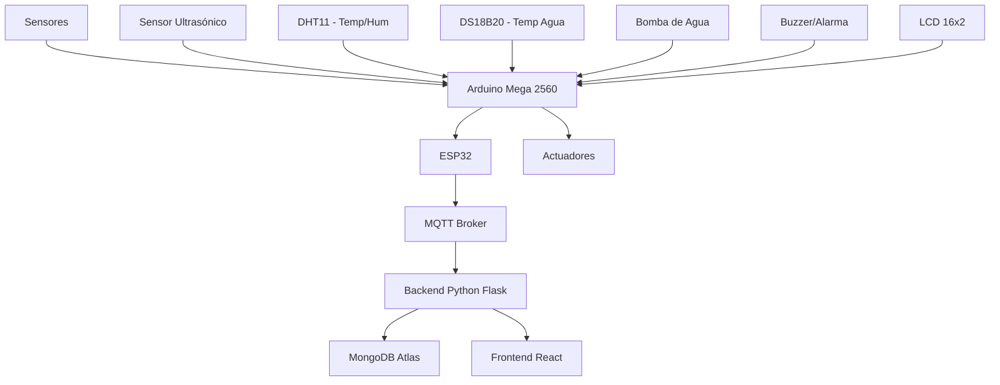

# 🌊 HydroGuard - Manual Técnico

## 🎯 Descripción General

**HydroGuard** es un sistema IoT completo para el monitoreo y control automático del nivel de líquidos, desarrollado como proyecto de Arquitectura de Computadoras 1. El sistema integra sensores, microcontroladores, comunicación MQTT y una interfaz web moderna para proporcionar control inteligente y autónomo.

## 🏗️ Arquitectura del Sistema



## 🔧 Componentes del Sistema

### 📱 Hardware
- **🎛️ Arduino Mega 2560**: Controlador principal con sensores y actuadores
- **📡 ESP32**: Módulo WiFi/MQTT para comunicación inalámbrica
- **📊 Sensores**:
  - Ultrasónico HC-SR04 (medición de distancia/nivel)
  - DHT11 (temperatura y humedad ambiente)
  - DS18B20 (temperatura del líquido)
- **⚙️ Actuadores**:
  - Relé para control de bomba
  - Buzzer para alarmas
  - LCD 16x2 I2C para visualización local

### 💻 Software

#### 🖥️ Backend (Python Flask)
```
📂 backend/
├── 🐍 app.py              # Aplicación principal Flask
├── ⚙️ config.py           # Configuración MongoDB
├── 📋 requirements.txt    # Dependencias Python
├── 🚀 start.bat          # Script inicio Windows
├── 🔧 start.ps1          # Script PowerShell
└── 📖 README.md          # Documentación backend
```

#### 🌐 Frontend (React)
```
📂 Frontend/
├── 📂 src/
│   ├── 📄 pages/Dashboard.js    # Dashboard principal
│   ├── 🎨 styles/Dashboard.css  # Estilos del dashboard
│   ├── 🔐 styles/Login.css     # Estilos de login
│   └── 🛣️ routes/AppRoutes.jsx # Rutas de la aplicación
├── 📂 public/
│   ├── 🌐 index.html           # Página principal
│   └── 🖼️ icon.ico            # Icono de la aplicación
└── 📦 package.json             # Dependencias Node.js
```

## 🚀 Instalación y Configuración

### 🔧 Prerrequisitos
- **Python 3.8+** 🐍
- **Node.js 14+** 📦
- **MongoDB Atlas** 🗄️
- **Arduino IDE** 💾

### ⚡ Configuración Rápida

#### 1️⃣ Backend Python
```bash
cd backend
pip install -r requirements.txt
python app.py
```

**🪟 Windows - Opciones alternativas:**
```bash
# Batch script
start.bat

# PowerShell
powershell -ExecutionPolicy Bypass -File start.ps1

# NPM (si tienes Node.js)
npm run start
```

#### 2️⃣ Frontend React
```bash
cd Frontend
npm install
npm start
```

#### 3️⃣ Hardware
- **🔌 Conectar Arduino Mega** con los sensores según el esquema
- **📡 Configurar ESP32** con las credenciales WiFi
- **🔄 Cargar códigos** `PROYECTO.ino` y `ESP32.ino`

## 📊 Funcionamiento del Sistema

### 🔄 Modos de Operación

#### 🤖 Modo Automático
- ✅ Control automático de bomba según nivel
- 📏 Nivel < 6cm → **Bomba OFF** + **Alarma ON**
- 📏 Nivel > 13cm → **Bomba ON** + **Alarma OFF**
- 📺 Rotación automática de pantalla LCD (3 páginas)

#### 🎮 Modo Manual
- 🎛️ Control manual de bomba via botón físico
- 📱 Control remoto desde dashboard web
- 📊 Monitoreo continuo de sensores
- ⚠️ Alertas informativas

#### 🚨 Modo Emergencia
- 🛑 **Bomba OFF** inmediato
- 🔊 Alarma intermitente
- 📵 Sensores deshabilitados
- 🚫 Sistema bloqueado hasta reset manual

### 📡 Comunicación MQTT

#### 📋 Topics del Sistema
```
silo/sensores     → 📊 Datos de sensores (CSV)
silo/prueba       → 💓 Heartbeat cada 5s
silo/cmd          → 🎮 Comandos al sistema
silo/status       → 📈 Estado general
```

#### 📥 Formato de Datos
**Sensores (CSV):**
```
D,distancia,temp_ambiente,humedad,temp_agua
Ejemplo: D,8.5,24.80,65.0,23.50
```

**Comandos (JSON):**
```json
{"accion": "ON/OFF", "dispositivo": "bomba/alarma"}
```

## 🌐 Dashboard Web

### 🎨 Características Principales
- **📊 Gráficos en tiempo real** con Chart.js
- **🎛️ Panel de control** para actuadores
- **📋 Tabla de datos históricos**
- **📱 Diseño responsive**
- **🌙 Tema dark** con efectos visuales

### 🔧 Funcionalidades
- **📈 Visualización de datos** en tiempo real
- **🎮 Control remoto** de bomba y sistemas
- **📊 Estadísticas y predicciones**
- **📁 Exportación** a Excel y PDF
- **🔔 Sistema de notificaciones** (Toasts)

## 🗄️ Base de Datos

### 📋 Estructura MongoDB
```javascript
{
  _id: ObjectId(),
  timestamp: ISODate(),
  temperatura: Number,      // °C ambiente (DHT11)
  humedad: Number,         // % relativa (DHT11)
  temp_agua: Number,       // °C líquido (DS18B20)
  distancia: Number,       // cm nivel (Ultrasónico)
  nivel_porcentaje: Number // % calculado
}
```

### 🔗 Conexión
- **🌐 MongoDB Atlas**: Cluster en la nube
- **🏪 Base de datos**: `mydatabase`
- **📦 Colección**: `lecturas_sensores`

## 🛠️ API Endpoints

### 📡 Backend Flask

#### 📊 GET `/api/sensordata`
**Descripción:** Obtiene datos históricos de sensores

**Parámetros Query:**
- `limit` (opcional): Número máximo de registros
- `sensor` (opcional): Tipo de sensor específico

**Respuesta:**
```json
{
  "success": true,
  "data": [
    {
      "_id": "...",
      "timestamp": "2025-01-XX...",
      "temperatura": 24.5,
      "humedad": 65.0,
      "temp_agua": 23.2,
      "distancia": 8.5
    }
  ],
  "total": 150
}
```

#### 📥 POST `/api/sensordata`
**Descripción:** Inserta nuevos datos de sensores

**Body (JSON):**
```json
{
  "temperatura": 24.5,
  "humedad": 65.0,
  "temp_agua": 23.2,
  "distancia": 8.5
}
```

## 🔒 Seguridad y Autenticación

### 🔐 Sistema de Login
- **👤 Usuario**: `admin`
- **🔑 Contraseña**: `123456`
- **🛡️ Protección de rutas** en React
- **🎫 Contexto de autenticación**

### 🔐 Variables de Entorno
```env
MONGODB_URI=mongodb+srv://...
MQTT_HOST=test.mosquitto.org
MQTT_PORT=1883
```

## 📈 Monitoreo y Logs

### 📊 Métricas del Sistema
- **📡 Conectividad MQTT**: Estado de conexión
- **🔄 Frecuencia de datos**: Cada 200ms
- **💓 Heartbeat**: Cada 5 segundos
- **📊 Almacenamiento**: Tiempo real en MongoDB

### 🐛 Debug y Troubleshooting
```bash
# Ver logs del backend
python app.py

# Ver logs MQTT (terminal separada)
mosquitto_sub -h test.mosquitto.org -t 'silo/#' -v

# Verificar datos en MongoDB
# Usar MongoDB Compass o Atlas interface
```

## 🎯 Casos de Uso

### 🏠 Doméstico
- **🚿 Tanques de agua**: Control automático de llenado
- **🌱 Riego de plantas**: Monitoreo de humedad
- **🔥 Calentadores**: Control de temperatura

### 🏭 Industrial
- **⚗️ Procesos químicos**: Control de nivel crítico
- **🌡️ Monitoreo ambiental**: Temperatura y humedad
- **🚨 Sistemas de alerta**: Emergencias automáticas

## 🚀 Mejoras Futuras

### 🔮 Funcionalidades Planificadas
- **🤖 Machine Learning**: Predicciones inteligentes
- **📱 App móvil**: Control desde smartphone
- **☁️ Multi-tenancy**: Múltiples usuarios/tanques
- **📊 Analytics avanzados**: Reportes detallados

### 🛠️ Optimizaciones Técnicas
- **⚡ WebSockets**: Datos más fluidos
- **🗂️ Base de datos**: Optimización de queries
- **🔒 Seguridad**: OAuth2/JWT
- **📦 Docker**: Containerización

## 👥 Equipo de Desarrollo

- **👥 Grupo 6**: Frontend React y integración
- **🎓 Curso**: Arquitectura de Computadoras 1 - 2S25

### 🆘 Problemas Comunes
- **❌ Error de conexión MQTT**: Verificar WiFi y broker
- **📊 Sin datos en dashboard**: Revisar backend y MongoDB
- **🔌 Hardware no responde**: Verificar conexiones y alimentación

---

**🎉 ¡Gracias por usar HydroGuard!**